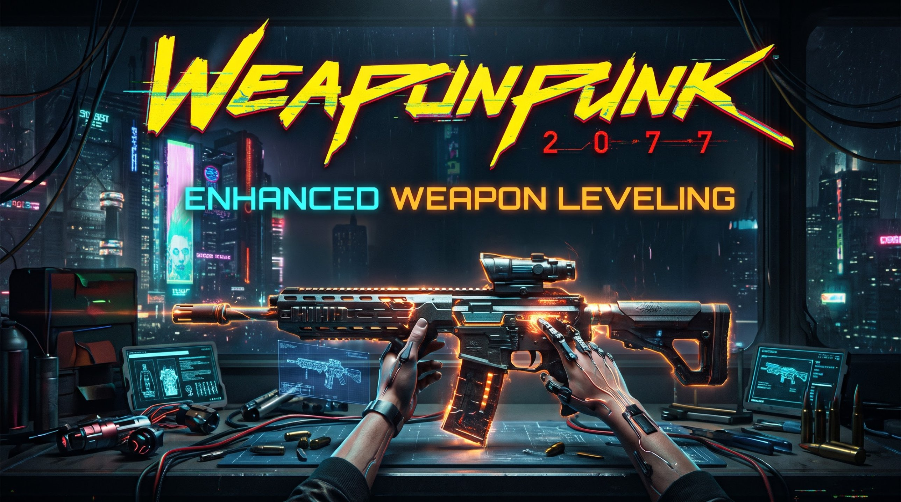
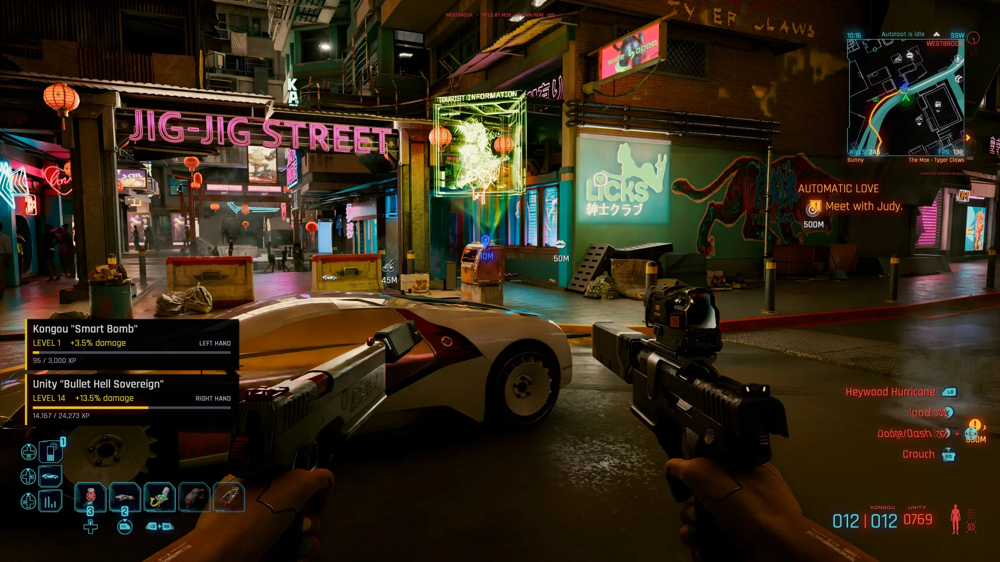
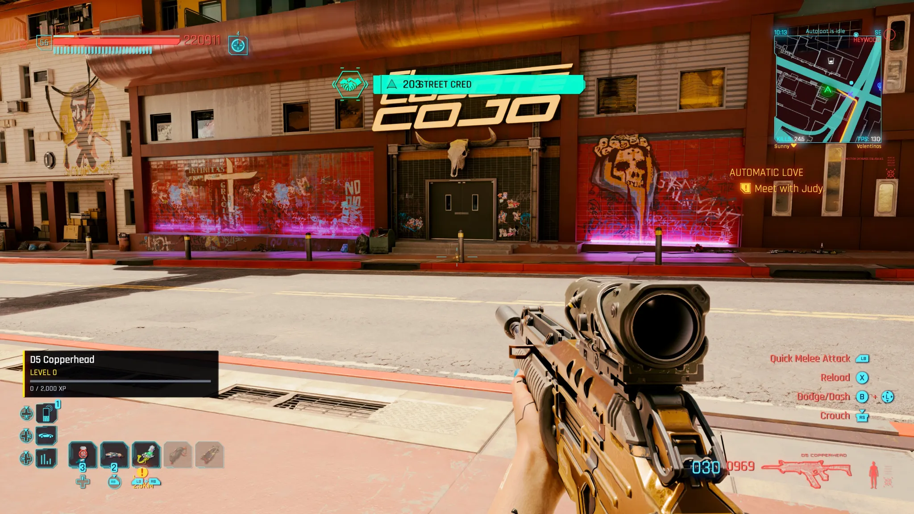
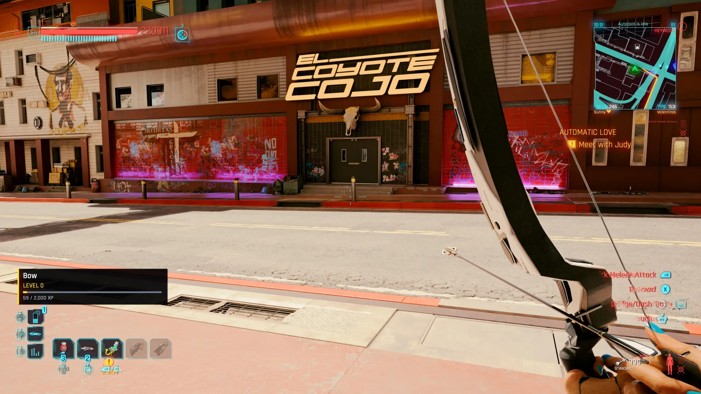
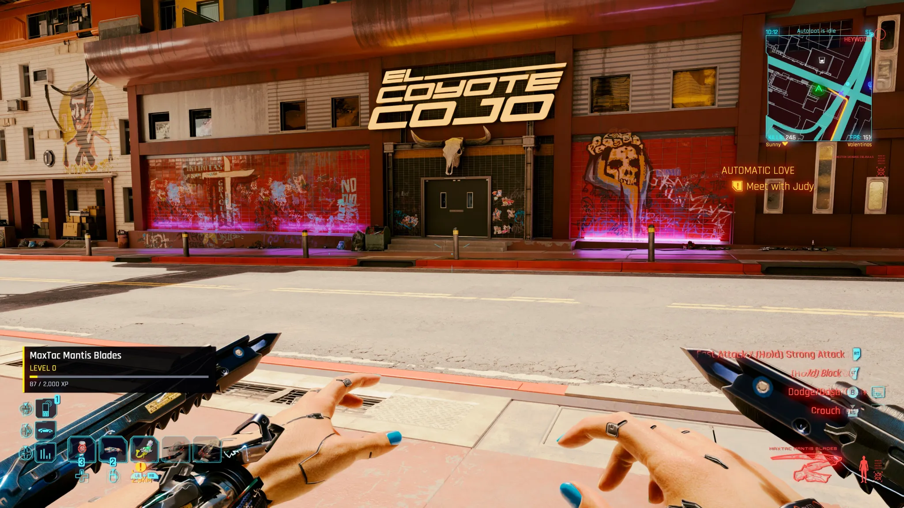
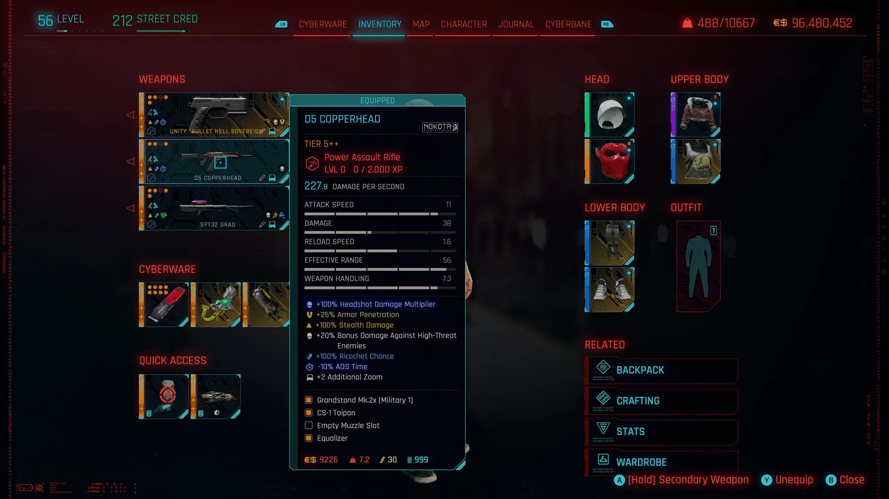
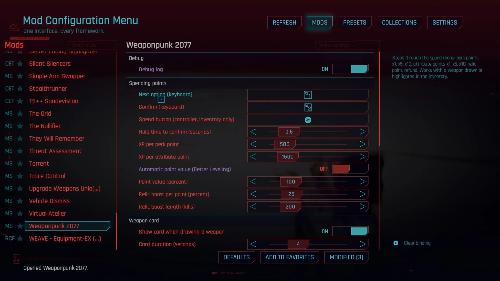
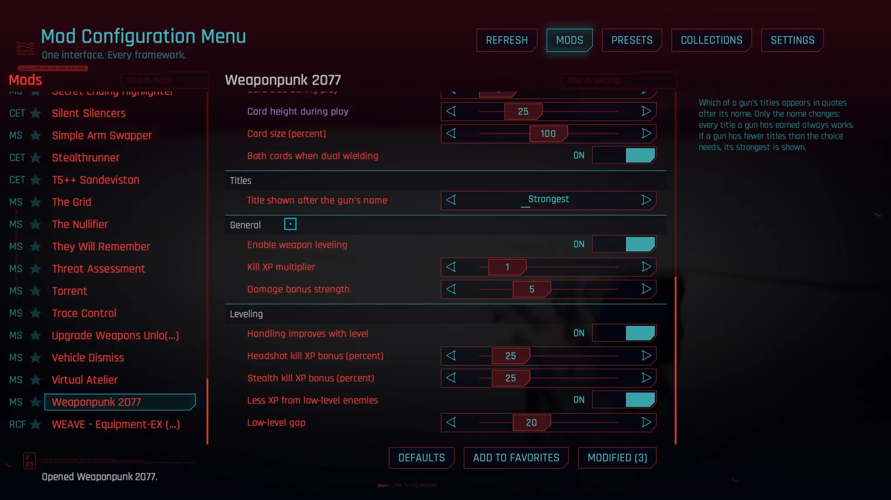
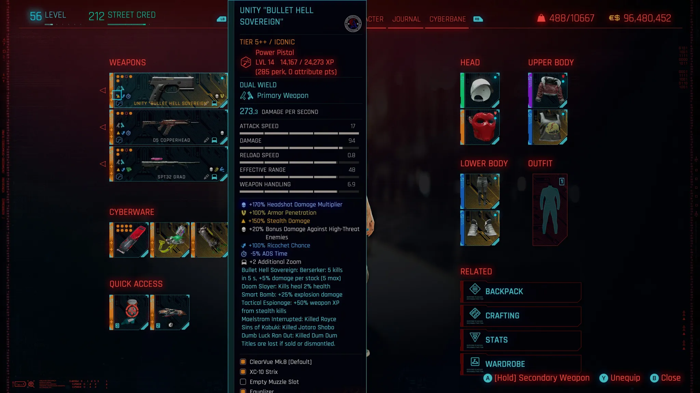

# Weaponpunk 2077 – Weapon Leveling Enhanced

*Your guns remember what you do with them. Some of what they remember is worth finding out for yourself.*

A weapon progression mod for Cyberpunk 2077 2.5 with Phantom Liberty. Your weapons level up as you use them, with no level cap, and each level makes them a little better. You can also put spare perk, attribute and relic points into a weapon.

This mod also includes a hidden system. No spoilers here: play and discover it. If you can't wait, [SPOILERS.md](SPOILERS.md) explains everything (spoilers, obviously).

**Status: public beta, v0.6.3 (card diagnostics).** Back up your saves.

## Features

- **Levels per weapon model.** All copies of a model share one level, so selling, dismantling or upgrading a gun never loses progress. Guns, melee weapons and arm cyberware all level.
- **Kill XP by enemy rank and type.** Elites, netrunners, heavies and mechs are worth more; drones less; civilians nothing. Headshot and stealth kills give extra XP, and enemies far below your level give half.
- **Vehicle and explosive kills count.** Shoot a car until it explodes and your gun gets XP for everyone inside.
- **No level cap.** Levels 1 to 5 cost 2,000 to 6,000 XP; after that each level costs 15% more than the last.
- **Bonuses per level.** Damage rises every level, each level adding a little less. Fire rate, reload speed and recoil improve up to a ceiling at level 20.
- **Spend your spare points.** Perk points (500 XP), attribute points (1,500 XP), and relic points (+25% kill XP for 200 kills, stacking to +100%). Refund a weapon's points at any time.
- **Better Leveling support.** With Better Leveling installed, point values scale automatically to its level cap and points per level.
- **Weapon card.** Shows the weapon's level, damage bonus and XP when you draw it. Its side, its height on screen (0 bottom to 100 top) and compact mode are settings.
- **Inventory tooltip line** with the weapon's level and XP.
- **Everything is configurable** in Mod Settings, and every setting explains what it does: kill XP multiplier, damage bonus strength, handling bonus, headshot and stealth XP bonus, reduced XP from low-level enemies, point values, relic boost size and length, keybinds and the weapon card.
- **Translatable.** All text, including every setting, can be translated with one add-on file. See [Translations](#translations).

## Screenshots

Unedited in-game capture: dual wielding, both weapon cards shown, each marked RIGHT HAND / LEFT HAND.

| | |
|---|---|
|  Weapon card on draw. Position, size and duration are all settings. |  Modded weapons level too, no patch needed (the Arclight bow comes from another mod). |
|  Melee weapons and arm cyberware level too. |  Inventory tooltip with the weapon's level and XP. |
|  Mod Settings (shown here in Mod Configuration Menu): spending points, keybinds, point values, relic boost. |  Mod Settings: kill XP, damage bonus, handling, headshot/stealth XP, low-level XP. |

<b>⚠ Spoiler screenshot: shows the hidden system. Click only if you don't want to discover it yourself.</b>

## Requirements

- Cyberpunk 2077 2.5 with Phantom Liberty
- [redscript](https://www.nexusmods.com/cyberpunk2077/mods/1511)
- [RED4ext](https://www.nexusmods.com/cyberpunk2077/mods/2380)
- [Codeware](https://www.nexusmods.com/cyberpunk2077/mods/7780)
- [TweakXL](https://www.nexusmods.com/cyberpunk2077/mods/4197)
- [Mod Settings](https://www.nexusmods.com/cyberpunk2077/mods/4885) (optional, needed to change any setting)

No REDmod. PC only: console mods on mod.io don't allow script extenders.

**Mod Configuration Menu (MCM):** supported. Weaponpunk's settings show up there like any other Mod Settings mod.

**Weapons from other mods** work out of the box, no patch needed. Anything the game counts as a weapon levels up and earns XP. A few hidden extras are tied to specific vanilla weapons, so those stay vanilla-only.

**Not compatible with Weapon Mastery.** Disable it before installing.

**Using [Upgrade Weapons Unlocked](https://www.nexusmods.com/cyberpunk2077/mods/9889)?** Turn off its **Iconic when reaching PlusPlus** option (Mod Settings → Upgrade Weapons Unlocked → Upgrade Options). Weaponpunk marks weapons that earn something special as iconic, and with both on, your inventory fills up with iconics and you can't tell the special guns apart.

## Installing

Copy the `r6` folder from this archive into your Cyberpunk 2077 game folder, so the files end up in
`Cyberpunk 2077\r6\scripts\WeaponLeveling\` and `Cyberpunk 2077\r6\tweaks\WeaponLeveling\`.

## Controls

| | Next option | Confirm | Works |
|---|---|---|---|
| Keyboard | NumPad 1 | NumPad 2 | with a weapon drawn, or highlighted in the inventory |
| Controller | tap Select / View | hold Select / View, then release | inventory only |

The first press only opens the menu, so a stray press never spends anything. Every button can be changed in Mod Settings.

## Removing

Use the refund option on any weapon you spent points on, then delete `r6\scripts\WeaponLeveling\` and `r6\tweaks\WeaponLeveling\`. Saves still load.

## Translations

All of the mod's text can be translated without touching its code. The translation kit is in the
[`translations`](translations/) folder here, and it's also an optional download on Nexus. It has a
template file, the same strings as a spreadsheet, and a step-by-step guide (`TRANSLATING.md`).

A translation is one `.reds` file that players drop into `r6\scripts\WeaponpunkLang\`. It loads
automatically when the game's language matches. Anything it doesn't translate shows in English.

## Reporting bugs

Turn on **Debug log** in Mod Settings, reproduce the problem, then send:

- `bin\x64\plugins\cyber_engine_tweaks\gamelog.log` (lines tagged `[WeaponLeveling]`)
- `r6\logs\redscript_rCURRENT.log` if the mod didn't load
- the newest file in `bin\x64\plugins\AdvancedCrashReporter\reports\` after a crash

## Credits

Inspired by Weapon Mastery (draw card and per-model progress). All code written fresh.

## License

GPL-3.0. See `LICENSE`. You may share and modify this mod, but anything built from it must stay open source under the same license.
